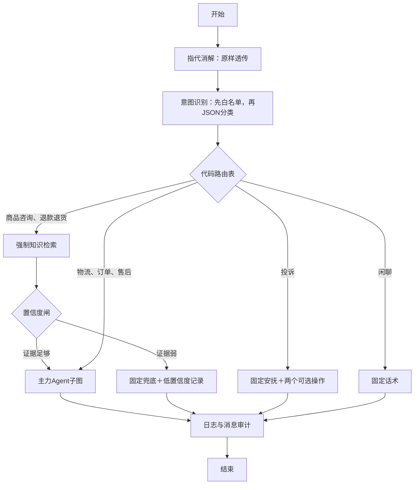

# 第五章：确定性Workflow与主力Agent设计

状态：2026-10-21用户已批准；2026-10-21。本文是设计稿，不表示实现已开始。

## 目标与已确认选择

沿用FastAPI、原生HTML/CSS/JS聊天页、OpenAI协议上游、第二章业务工具、第三/四章检索器。LangGraph负责确定性分流、State和持久化；主力Agent只在允许的分支执行ReAct。

- 已确认新增独立PostgreSQL容器，使用官方AsyncPostgresSaver；MySQL继续保存业务表、消息流水、工单和低置信度池。
- 已确认闲聊白名单零模型调用。其他消息最多一次意图分类，判为闲聊后不进入Agent。白名单要求整句命中，不能把“你好，查一下订单1001”短路成闲聊。
- 指代消解节点原样透传，不新增正式指代、多轮改写或上下文策略。
- 上一轮喵喵优选文档与300题继续暂存，等待补齐后另行完成已授权的知识替换；本章先使用当前已验收知识库，不混入半套新政策。

## 方案比较

A（推荐）：父图做Workflow，主力Agent为ReAct子图。每个模型决策和工具执行边界都能进入State/checkpoint，节点轨迹清晰，易于验证停止条件。

B：父图做Workflow，Agent节点内部保留Python while循环。代码较短，但整个循环只有节点级checkpoint，步骤恢复与状态观察较弱。

采用A。热身保留独立的原生Python while示例，之后把相同决策、工具执行与终止规则拆为LangGraph节点；不另外增加Agent框架或新业务工具。

## 图结构与固定路由

路由表写在Python代码中。模型只能输出七类意图枚举，不得自行决定图出口。JSON无效、分类超时等均走可控失败路径并记日志，不猜成知识或业务分支。

退款退货必须先检索政策；通过闸后，Agent可继续查询订单。物流、订单、售后分支没有预检索，也不经过父图置信度闸。分类Prompt和样例明确区分政策咨询与具体业务进度；含投诉诉求时优先投诉出口。

## 热身裸循环

提供独立演示命令：原生Python while + OpenAI协议HTTP请求；有tool_calls时使用第二章工具执行器，追加assistant申请与匹配tool_call_id的tool结果，再次请求LLM；没有工具申请时收敛。

不使用LangGraph或Agent构造器编排热身循环。业务工具仍复用既有实现，不复制模拟电商数据逻辑。演示只暴露可读取工具，创建工单仍必须经用户按钮确认。输出工具步骤和停止原因，不输出模型私有思考过程。

## 主力Agent子图

Agent子图为“决策 → 执行一个工具 → 回灌 → 再决策”，最后进入“最终回答流”。每次模型决策最多允许一个工具申请，避免简单并行调用冒充依赖中间结果的多步推理。

- 简单物流问题可直接query_logistics并收敛。
- 复杂演示用“先查订单1001的状态，再查该订单物流并汇总”，要求日志中至少两次工具执行，且第二次模型决策发生在第一次工具结果回灌之后。
- 缺订单号等必要信息时追问，不猜参数。
- 复用query_order/query_product/query_logistics/query_faq；复用注册、Schema校验、错误处理和有限重试。
- create_ticket不放入Agent可执行集合。服务端执行器也校验权限，不能只靠Prompt禁止自动写工单。
- 没有工具调用时，模型输出严格终结控制JSON：answer/clarify/fallback和suggested_actions。验证通过后进行最终文本生成；控制JSON不显示给用户。
- suggested_actions仅允许handoff、ticket，最多各一个。它们是响应元数据，不是新增业务工具，不产生业务副作用。

默认上限：6次工具迭代、6次工具执行；同轮重复相同无进展调用提前停止。设置累计模型token预算（初始建议24000，可配置）、单请求输入/输出预算与总时限。每次请求前检查剩余预算；有usage时记录真实消耗，无usage时记录保守估计并明确标注。达到上限用本地兜底，不无限请求模型。

保留现有完整回合裁剪；不新增摘要、长期记忆或上下文管理策略。工具申请与结果必须成对保留。

## 检索与前置置信度闸

检索节点复用第四章HybridRetriever（dense+BM25/RRF+rerank和品类过滤）。该节点先得到当轮证据，之后由独立置信度节点做判定，不能把判断放到流式输出之后。

简版闸复用已有分数阈值、证据非空/有效性和第四章已有充分性检查，不新增另一套正式置信度模型。证据裁剪按完整块；预算改变证据时重新判断。通过后才把证据、引用与问题交给Agent。失败直接返回固定兜底并写现有low_confidence_questions；服务不可用与证据不足分别记录。

本章不做飞轮入库。知识回答仍遵守第四章有效引用与禁止承诺约束；业务工具的模拟结果继续标演示数据。业务分支若主动调用FAQ工具，沿用该工具现有知识约束，但父图不对无证据的业务问题套预检索闸。

## State、持久化和审计

使用显式Workflow State，保存可序列化的数据：conversation_id、turn_id、原话、透传问题、意图、messages、当轮证据、闸结果、步骤计数、usage、建议操作、操作状态、终止状态及节点轨迹。不把HTTP客户端、数据库连接或工具实例放进checkpoint。

AsyncPostgresSaver在FastAPI生命周期内管理；启动/初始化时执行官方setup，thread_id绑定conversation_id。每轮重新初始化临时意图、证据、计数，不能复用前轮闸结论。

State/checkpointer是图的会话状态来源；MySQL消息流水为审计投影。旧会话第一次进入图时，仅导入旧已完成历史；之后不把两份历史拼接。正常出口统一汇入日志节点；异常、超时、用户断开由外围清理路径补failed/cancelled审计。

日志包含节点名、分支、工具名/调用ID、耗时、token实际值或估计、闸结果和终止原因。保证同一turn的审计投影幂等；必要时新增小型workflow_runs/审计凭据表，不新增业务工具。MySQL与PostgreSQL不宣称分布式事务，依赖幂等和可重试恢复处理跨库中断。

同一conversation的聊天与按钮写操作串行化；PostgreSQL侧会话锁避免多进程同时推进同一thread，不同会话可并行。工单仍依靠现有数据库唯一幂等键防重复。

新增独立compose.checkpoint.yaml及命名卷；凭据仅放.env，不占用其他项目已有数据库端口。默认候选本机16432，启动前检查冲突。业务MySQL/Milvus原卷保留。

## 两个独立前端操作

投诉出口返回固定安抚及handoff/ticket两个建议，不进入Agent。Agent可建议一个、两个或都不建议。后端只把建议写入State并通过SSE actions帧交前端。

- 转人工：前端模拟确认后，显示“已转接人工客服”，再插入“您好，我是客服小猫，请问有什么可以帮您的”。不调用工单接口，不写tickets，不接真人系统。
- 建工单：独立按钮，先展示问题描述/工单类型并确认；用户确认后才调用后端接口。后端用持久化建议ID、会话和来源回合校验，再调用第二章create_ticket；重复点击或网络重试返回同一工单。
- 两个按钮的状态各自独立。转人工不等于建工单，建工单不自动触发转人工；都不点时没有动作，用户可继续正常聊天。
- 建工单属于独立确认操作回合，记录来源建议，不能把任意客户端文本当已批准的工单事实。旧回合建议由持久化状态验证，界面刷新后仍可核对已执行状态。

前端只扩展现有原生聊天页的按钮、确认交互和状态渲染；保持来源引用、工具徽章和满意度反馈。

## SSE和失败边界

保持/chat的SSE与conversation_id协议，继续发meta/status/tool_start/tool_end/token/citations/done/error，新增actions与可观察的workflow节点状态。只把最终回答token送到正文；分类JSON、模型控制JSON和工具参数不作为回答显示。

闲聊/投诉/前置兜底使用本地文本帧，不调用最终生成模型。知识回答有效引用单元验证后输出模型片段，维持第四章拦截非法引用的行为。总时限、客户端断开和异常均关闭上游流、释放会话锁并标记状态；不自动执行建议操作。

## 验证与交付

后端按TDD：固定路由表、白名单零调用、分类无效、知识强制检索和闸前置、弱证据不进Agent、业务绕闸、循环步数/token终止、工具顺序、消息配对、checkpointer重启恢复、会话串行、按钮幂等及禁止Agent写工单。

Prompt/数据用标注样例验证七类意图及边界，不用镜像实现的单测冒充分类质量。前端沿用此前聊天页直接迭代偏好，以真实浏览器验证两个按钮、确认、零点击继续聊天、引用/反馈不回归。独立代码评审关注后端副作用与恢复边界。

真实验收：政策日志必有retrieve/confidence_gate；订单1001物流工具作答；“我要投诉”两个独立按钮，handoff不写工单、确认ticket才新增且重试不重复；白名单闲聊模型调用0；依赖中间结果的复杂请求至少两步；重启后同会话能读回State与已执行建议。

交付裸循环、服务启动、curl/页面、测试和验收命令；报告真实结果与限制；每阶段即时追记dev-notes/ch05.md。保留当前本地分支，不默认推送/合并。

## 官方文档调研依据（Context7）

- https://docs.langchain.com/oss/python/langgraph/workflows-agents
- https://docs.langchain.com/oss/python/langgraph/add-memory
- https://docs.langchain.com/oss/python/langgraph/checkpointers
- https://docs.langchain.com/oss/python/langgraph/persistence
- https://docs.langchain.com/oss/python/langgraph/streaming

实现前继续通过Context7核对实际安装版本的LangGraph、LangChain、FastAPI、SQLAlchemy及checkpoint依赖接口，固定兼容版本；不照抄文档中可能尚未安装的stream v3接口。

## 设计自审

已覆盖七类到四出口的固定映射、裸循环先行、ReAct子图、前置闸、State持久化、两动作互不绑定、点击后副作用、token/步数/时限、幂等/取消恢复和真实验收；已确认PostgreSQL及闲聊口径。没有实现代码或新增业务工具。
