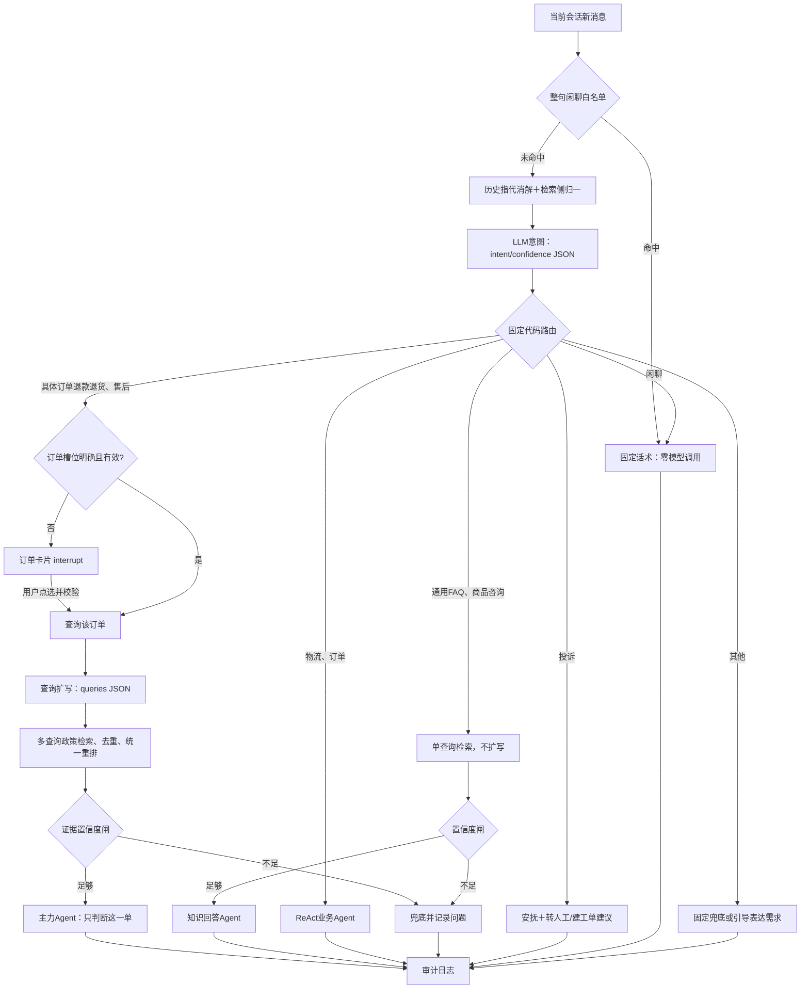

# 第六章：正式分流器与退款售后确定性子流程

状态：2026-10-21用户已批准。2026-10-21。本次先补齐第五章底座，再交付第六章，分别留痕；本文与第五章设计一起评审。

## 已确认范围

- 仓库实现目前到第四章。用户已确认本次补第五章LangGraph Workflow/State/ReAct/checkpointer，再实现第六章。
- 第五章已确认独立PostgreSQL + 官方AsyncPostgresSaver；业务数据继续MySQL。第六章不引入新组件、分类模型或外部服务。
- 已确认：通用退款/售后FAQ不选订单、不扩写；具体订单诉求才走订单→扩写→政策检索→判断。
- 保留第五章闲聊白名单零模型调用；其他消息做意图识别，闲聊不进Agent。
- 喵喵优选新原文与300题继续暂存，等待用户补齐缺失章节后另做已授权的知识替换。当前章节用已验收知识库验证流程，不把原文缺失题拿来冒充分类/指代质量问题。

## 方案比较

A（推荐）：固定Workflow承载规范化、分类与退款子流程；退款步骤和订单选择均为显式节点，Agent只做最后的资格解释/判断。可检查每条边、暂停和恢复，用户点选后不会由Agent猜测执行。

B：把扩写、选单、查订单都交Agent自由调用。较短，但不能保证先查订单再检索政策，槽位约束与恢复也不清晰，不能满足本章确定性要求。

采用A；主力Agent依旧保留在其他业务分支与最终判断位置，不代替分流器。

## Workflow



“意图是什么”与“这一轮需要哪些执行槽位”分离。意图JSON只含两字段；通用FAQ与具体订单任务的执行分支由独立代码规则判断，规则与边界样例可测试。分类节点不问退款原因、不为凑槽位追问用户。

## 指代消解与Query改写

LLM读取当前会话既有预算内、已完成历史，明确“它/这个/那单”指向。保留raw_question；resolved_question只在确有指代且对象能确定时补全，完整问题原样保留。单独的retrieval_query用于口语归一，不能覆盖用户原话。

结构化内部结果可包含resolved_question、retrieval_query、referenced_order_id；它不同于意图JSON。订单ID、SKU、数字和否定条件不能杜撰、替换或跨对象互换。新增指代实体必须能在当前消息、用户已确认选择或可信历史工具结果中找到依据。多个候选无法确定时保留歧义，不默认选最后一单。

当前会话可用历史，不读取其他会话；不新增摘要或跨会话记忆。每轮重新计算意图，不能沿用前轮的退款意图覆盖当前物流请求。

## 意图识别

八个最终枚举：物流、订单、商品咨询、退款退货、售后、投诉、闲聊、其他。七个业务/对话选项加“其他”兜底。

对外/日志结构严格为：

```json
{"intent":"退款退货","confidence":0.93}
```

禁止第三字段；confidence是0至1有限数。Prompt包括选项定义、严格JSON Schema、边界few-shot和不确定时选其他的规则。few-shot覆盖投诉与物流、物流与订单、通用售后政策与具体故障、闲聊与怪问题、话题切换等。

默认使用现有上游的主力大模型，intent模型名可在.env单独指定，未设时继承既有主力模型。先用标注集验准确率，不默默换供应商。可选成本降级模式：配置小模型后先判一次，低置信度才交主力大模型重判一次；最多两次，无递归升级。默认不启用降级。模型自报confidence不是校准概率；阈值从独立校准样例选择。

非法JSON、范围错误或分类不可用走受控失败，不擅自填成业务意图；无法确定的有效结果落其他。其他出口不自动查订单、不创建工单。

## 退款售后子流程与槽位

具体订单请求先确定order_id：明确原话可用；已可靠消解的历史订单可用；其余进入订单选择节点。不能让LLM补一个不存在的订单号。浏览器首次不带订单问“这个能退吗”，没有明确历史对象时必须出现卡片。

当前系统无真实订单列表接口。继续演示边界：在既有MySQL中准备少量可复现的演示订单与所属演示用户，提供后端列表供卡片展示。卡片显示订单号、商品/型号、状态、金额和可用的下单/签收时间，显式标“演示”。不新增业务组件；现有query_order工具的入参保持order_id，按需补充订单事实字段。未提供的商品状况保持未知，不编造完好/未使用等退款条件。

后端校验用户点选的订单确实属于当前演示用户及本次可选集合；点选请求带conversation/turn/selection标识，不能靠任意客户端order_id绕过校验。查订单是独立节点，必须完成后才扩写和检索。

用LangGraph interrupt暂停，使用相同thread/checkpoint的Command恢复。官方语义是恢复会重新运行中断节点，故选单节点只负责展示/校验；查订单、申请提交等操作分到后续节点，重试幂等。等待选单期间stream发出order_selection及paused事件；不能伪报done。

用户点选自动回填并继续，无需手动重发整句。等待中用户改问物流等新问题时，旧等待轮标为已被替代，重新分类新消息；旧卡片不可恢复到新一轮。重复点击返回已有结果或明确过期，不重复推进流程。

## Query扩写与多查询检索

仅具体订单退款退货/售后执行扩写。通用FAQ、商品咨询、物流、订单、闲聊等不扩写。扩写在查到订单后，以已知订单事实和完整问题生成2至3条不同侧重点查询；不猜退款原因、不引入未提供的损坏事实。

扩写输出严格只有：

```json
{"queries":["该商品的退货适用范围和期限","退货例外与商品完好条件","相关退换货运费和申请流程"]}
```

Schema限制数量、长度、空项与重复；无效输出回退为原标准查询并记录降级，不凭空产生附加条件。原查询保留为检索输入，扩写不替换问题含义。

每条查询仍走第四章Milvus原生dense+BM25/RRF；并行度有上限。按chunk_id合并去重，对跨查询候选按秩合并并限制总候选量，再针对完整主问题统一用现有bge-reranker-v2-m3重排Top-10，避免不同查询的原始分数直接混排。继续MySQL原文/hash/状态复核、品类过滤、整块预算和引用编号。

知识库不复制同义文档，不更改入库结构。模型只看到合并后的当前订单及当前政策证据；退款分支Agent工具权限关闭或严格限于判断所需读取，不能回头替代固定流程，更不能执行退款。

## 主力Agent与退款申请表单

退款售后Agent仅判断“这一单按当前证据是否可申请/不符合/尚缺条件”，不能承诺已审核通过或到账时间。事实不足的需求澄清由Agent处理，但不得追问退款原因来补槽位。必要商品状态问题和退款原因不是同一件事。

退款表单由用户自选固定原因：不想要了、质量问题、运输破损、发错商品、少件漏发、其他。可附备注；原因不由LLM猜测或预选。前端展示订单信息、原因下拉和确认提交。

当前无真实支付/售后提交接口。表单提交只保存MySQL本地演示申请记录，显示“退款申请已提交（演示）”，不触发实际退款、不冒充平台审批。服务端验证订单、来源建议与原因枚举，唯一幂等键防重复。明确不符合条件时解释政策；需要人工时复用第五章独立的转人工/建工单选项。

第五章转人工仍仅前端模拟；建工单仍独立确认后调用原create_ticket，二者与退款申请各自独立。Agent不能自动发起其中任何写操作。

## State、持久化与SSE增量

沿用第五章State/checkpointer，加入raw/resolved/retrieval问题、intent/confidence、有效订单引用、selection状态、订单事实、queries、证据、闸结论及退款申请建议ID。存数据，不存客户端实例。每轮重置意图/检索临时字段，保留本会话确认事实。

消息和节点日志分别记录指代前后、最终意图与降级次数、任务分支、订单选择/恢复、工具顺序、扩写查询、去重数量、闸结果和停止原因；不输出私有思考过程或密钥。

保持既有meta/status/token/citations/tool/done/error协议，新增order_selection/paused与表单建议事件。最终答复仍流式；分类与扩写JSON不泄漏为气泡正文。并发、断线、过期选择及中断恢复的处理继承第五章串行/幂等边界。

## 测试、评估与验收

后端TDD：严格JSON键与类型、跨订单约束、FAQ跳过选择/扩写、具体订单强制顺序、缺单不猜、选单恢复与过期校验、去重/重排/预算、枚举原因、确认后写入与重复提交幂等，以及第五章所有副作用保护。

Prompt与数据使用独立标注样例，不训练模型。构造多轮会话：物流→退款→物流、明确订单与歧义多订单、完整问题不改写、口语标准化、未知问题归其他。few-shot/校准/验收样例分开；分别报告指代准确率、意图准确率、JSON可解析率、其他兜底、升级次数与失败样本。用户指定的核心多轮验收组要求逐轮正确，不以平均分掩盖错轮。

前端按Vibe Coding直接迭代，浏览器验证首轮无订单号弹卡片、点选回填后继续、原因未被LLM预填、确认后提交、两操作互不绑定、改问物流后旧卡片失效。前端不套brainstorm/TDD/code review；后端仍完整评审。

阶段顺序：确认合并设计→写实施计划并评审→第五章裸循环/Workflow/State与checkpointer→正式分流/指代/扩写→订单中断子流程→表单与前端→独立后端review→真实验收/finish。每阶段即时更新ch05/ch06对应日志。

交付两章运行与演示命令、测试结果、标注评估报告、阶段记录；本地保留分支，不默认推送合并。

## 调研与自审

Context7已核对LangGraph官方interrupt/Command、子图恢复重跑、副作用分离，以及第五章StateGraph/streaming/AsyncPostgresSaver接口。具体实现前继续查LangChain结构化输出、FastAPI/SQLAlchemy及实际安装版本，固定兼容版本。

参考：https://docs.langchain.com/oss/python/langgraph/interrupts

自审：已覆盖指代与完整问题透传、检索侧归一/扩写、八枚举JSON、强模型与一次升级、退款售后固定顺序、槽位选择恢复、原因自选、无跨会话记忆、前端例外及旧知识待补范围。演示订单和本地申请单的边界已明确列出待用户随设计批准，不默认为真实电商接入。
